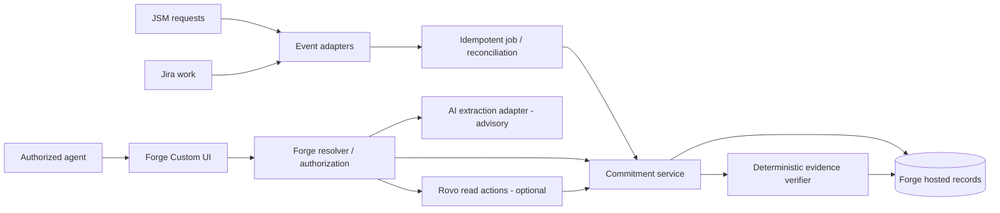

# Architecture and runtime boundaries

Use `app/` for Forge code (`src/backend`, `src/domain`, `src/adapters`, `static/frontend` as scaffold permits). Keep pure domain evaluator independent of Atlassian API for offline unit tests. Forge frontend must never own authorization or secret-bearing service calls. Use resolvers to map authenticated request to authorized records. Start with Forge KVS / Custom Entity Store after verifying query/index and transaction semantics. Reconciliation must tolerate at-least-once delivery and missed events.

## Data flow
JSM issue fetched via permitted API -> candidate extraction (manual-first optional LLM) -> reviewed contract -> linked Jira work -> source updates -> evidence reevaluation -> review -> independent acknowledgement -> fulfillment. Graph consists of app-owned references; Teamwork Graph enrichment is optional and must not be confused with an app-provided graph connector.

## Design limits
Verify actual JSM product support and account restrictions: Forge JSM does not support anonymous help seekers/customer accounts as Forge app UI users. Keep operator-facing interface for Atlassian-authenticated users; do not promise an external customer portal. Verify Jira platform/JSM API details via Forge MCP. Do not assume cross-product access without corresponding installation/scopes. `requestJira` asUser/asApp behavior and permissions must be tested separately.

## Failure modes
Denied API => fail closed on fulfillment. Missing page/site => show unavailable. Repeated event => idempotent no-op. Stale version => review required. Offline LLM => manual commitment creation remains functional. Forge queue limits => pagination and bounded processing; no flooding retries. Tenant uninstall => respect Forge lifecycle data policies.
